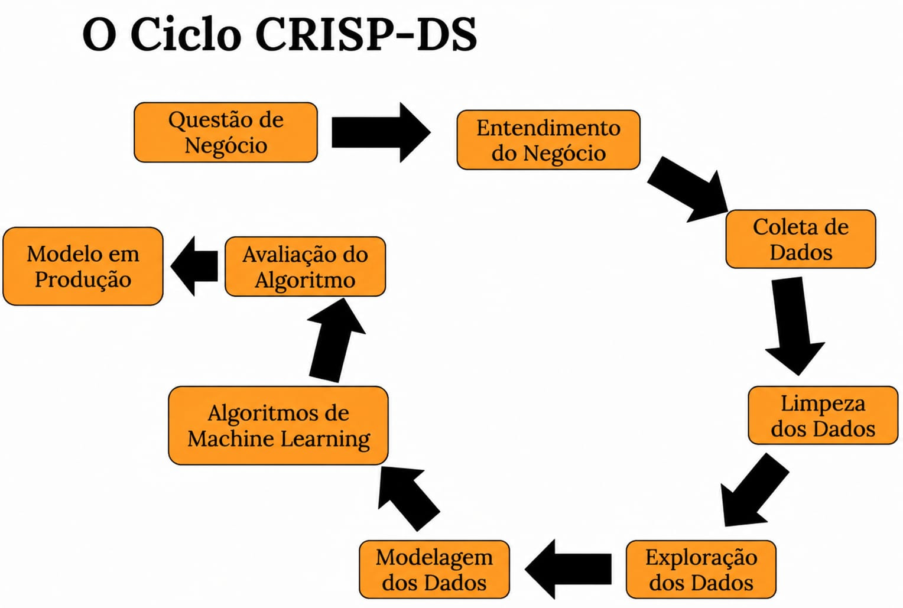
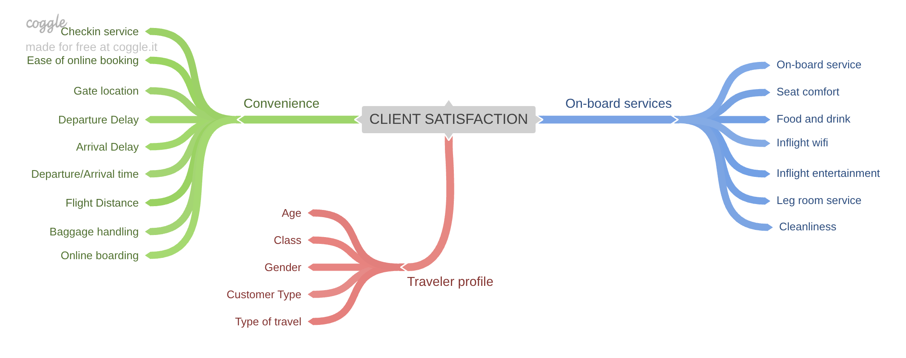
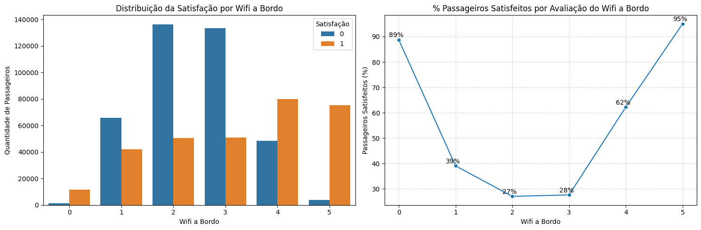
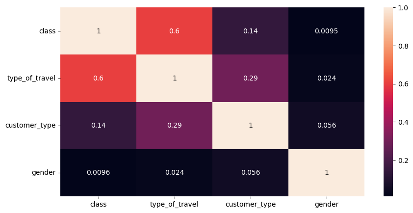

# Previsão da satisfação de companhias aéreas

## Análise curva ROC

A avaliação da análise será com base na área sob a curva ROC (Receiver Operating Characteristic), para avaliar o desempenho de modelos de classificação de satisfação de forma binária na comparação do cálculo de probabilidade prevista e o resultado observado através de modelos de Machine Learning como Logistic Regression, Random Forest, XGBoost e LightGBM.

### Problema de Negócio

O resultado deve fazer a previsão da probabilidade para a variável de satisfação.

#### Base de Dados

train.csv - conjunto de treinamento, com a satisfação como alvo. 
test.csv - conjunto de teste, utilizado para prever a probabilidade de satisfação. 
sample_submission.csv - arquivo de submissão de exemplo no formato correto. 

[Kaggle](https://www.kaggle.com/competitions/playground-series-s6e10/)

#### Campos de Dados

- id - ID que representa uma pesquisa de satisfação do conjunto de teste. 
- Age - Idade do respondente. 
- Flight Distance - Distância do vôo. 
- Inflight wifi service - Satifação com o serviço de wifi disponibilidade. 
- Departure/Arrival time convenient - Satifação com horário de conveniência do partida e chegada. 
- Ease of Online booking - Satifação com Facilidade de reserva online. 
- Gate location - Satifação com localização do portão de embarque. 
- Food and drink - Satifação com comida e bebida a bordo. 
- Online boarding - Satifação com serviço de check-in. 
- Seat comfort - Satifação com conforto do assento. 
- Inflight entertainment - Satifação com entretenimento a bordo. 
- On-board service - Satifação com serviço a bordo. 
- Leg room service - Satifação com serviço de espaço para as pernas. 
- Baggage handling - Satifação com serviço de manuseio de bagagem. 
- Checkin service - Satifação com serviço de check-in. 
- Cleanliness - Satifação com limpeza. 
- Departure Delay in Minutes - Atraso na partida em minutos. 
- Arrival Delay in Minutes - Atraso na chegada em minutos. 
- Gender - Gênero do respondente. 
- Customer Type - Fidelização do respondente. 
- Type of Travel - Tipo de viagem. 
- Class - Classe do vôo. 
- satisfaction - Resposta de satisfação em VERDADEIRO ou FALSO. 

### Premissa de Negócio

### Estratégia de Solução

O objetivo do projeto é prever a satisfação do cliente em relação à compania aérea.
O modelo adotado busca prever a resposta de satisfação dos clientes que utilizaram os serviços da compania aérea.
O formato de entrega contém informações de ID do passageiro respondente da pesquisa e a previsão de resposta de satisfação.

#### Planejamento do Processo de Análise

O processo de desenvolvimento do projeto teve como base o método CRSIP-DM, aplicando os seguintes passos:

1. Questão do negócio:
   Identificação e entendimento do problema de negócio. Idendificar a resposta de satisfação dos passageiros respondentes da pesquisa em relação ao serviço da compania aérea.

2. Entendimento do negócio:
   Entendimento do core business do negócio a fim de identificar a melhor estratégia de análise a ser implementada e foco na resolução do problema.

3. Coleta de dados:
   Seleção de dados disponibilizados em 3 bases em formato csv (train.csv, test.csv e sample_submission.csv) no site Kaggle. Predicting Airline Satisfaction. Disponível em: <https://www.kaggle.com/competitions/playground-series-s6e10/data>. Acesso em: 01 out. 2026.

4. Limpeza de dados:
   Foram realizadas limpeza e tratamento de formatação dos dados de acordo com padrões documentados; padronização do formato dos títulos das variáveis; formatação do tipos e grandezas dos campos de análise; inclusão de valor de minutos no conjunto de dados de atraso de chegada cujas pesquisas não apresentavam informações no campo "arrival_delay_in_minutes"; tratamento ou remoção de campos vazios e remoção de atributo “id” cuja dimensão é irrelevante para a análise atual.

5. Exploração de dados:
   A etapa de exploração de dados consistiu no levantamento das hipóteses e análise descritiva dos dados para visão do cenário inicial de informações, volume de dados e seleção de variáveis numéricas e categóricas para análise univariada.
   Foi desenvolvido mapa mental de hipóteses para levantamento de trinte e uma hipóteses a serem validadas ou refutadas através da análise exploratória dos dados (EDA) nos campos do fenômeno analisado satisfação do cliente: serviços de conveniência, serviços a bordo e perfil do cliente.

Elementos de mapa mental de hipóteses:

- Fenômeno: campo a ser medido ou modelado (variável resposta = y);
- Agentes: agentes que impactam seu fenômeno (variáveis independentes = x);
- Atributos do agente: características dos atributos.

Hipóteses são geradas por:

- Surpresa: insight com hipóteses não analisadas;
- Teste de crença: verificar se a contraposição da crença é validada ou não. Isto é, validação da hipótese nula (H₀) ou da hipótese alternativa (H₁).

Das 22 hipóteses levantadas, 11 foram selecionadas para validação através de análises univariadas, bivariadas e multivariadas de variáveis numéricas e categóricas do conjunto.

#### 11 Hipóteses:

1.  Facilidade de autoserviço online de agendamento aumenta o nível de satisfação do cliente.
2.  O atraso na saída ou na chegada do vôo diminuem a satisfação do cliente.
3.  Distâncias maiores de vôo diminuem a satisfação do cliente.
4.  Quanto maior a satisfação com o serviço a bordo maior a satisfação do cliente.
5.  Quanto maior a satisfação com o serviço de wifi a bordo maior a satisfação do cliente.
6.  Quanto maior a satisfação com o serviço de entretenimento a bordo maior a satisfação do cliente.
7.  Quanto maior a satisfação com o conforto do assento maior a satisfação do cliente.
8.  Quanto maior a satisfação com o serviço de limpeza a bordo maior a satisfação do cliente.
9.  A classe de viajante Eco tem menor nível de satisfação.
10. O cliente fidelizado tem maior nível de satisfação.
11. Viajantes a trabalho tem maior nível de satisfação.

#### Top 3 Insights

H1 Facilidade de autoserviço online de agendamento aumenta o nível de satisfação do cliente.
**VERDADEIRA** A facilidade de autoserviço online de agendamento aumenta o nível de satisfação do cliente. 
  

H5 Quanto maior a satisfação com o serviço de wifi a bordo maior a satisfação do cliente.
**VERDADEIRA** Quanto maior a satisfação com serviço de wifi a bordo maior a satisfação do cliente. 
  
H11 Viajantes a trabalho tem maior nível de satisfação.
**VERDADEIRA** Viajantas a trabalho tem maior nível de satisfação. 
  

### Modelo de Machine Learning

A preparação dos dados numéricos consistiu em Rescaling para variáveis não Gaussianas, isto é, variáveis sem distribuição normal. Já para a transformação de variáveis categóricas em numéricas foram utilizados encodings mantendo a natureza do conjunto de dados para torná-las mensuráveis e One Hot Encoding para categorização binária (0,1) para cada variável resposta das categorias "gender", "customer_type", "type_of_travel", sendo 1 na label da variável a resposta positiva. Ordinal Encoding para categorização ordinal da categoria "class" de acordo com a graduação Eco=0, Eco Plus=1, Business=2.
Para a seleção de variáveis relevantes no modelo, foi aplicado para variáveis numéricas o método de matriz de correlação e para as variáveis categóricas o método Cramer's V, que associa a correlação entre duas variáveis categóricas baseada no teste Qui-Quadrado. 
Matriz de Correlação - variáveis numéricas
 

Cramer's V - variáveis categóricas
 

Ainda para seleção de variáveis relevantes para acurácia do modelo, foi aplicado o método Boruta. De acorod com os resultados sete variáveis independentes deveriam ser removidas da análise: "age", "arrival_delay_in_minutes", "departure_arrival_time_convenient", "departure_delay_in_minutes", "food_and_drink", "gate_location", "gender_Male". 

#### Single Performance

A base de dados train.csv foi dividida em 80% treino e 20% validação, sendo treinado pela base treino e validado na base validação, de mesma estrutura porém com dados novos. Foram treinados quatro métodos de modelos: Logistic Regression, Random Forest Regressor, LightGBM, XGBoost Regressor. Sendo o Average Model (modelo de média) o modelo de referência para performance de comparação dos demais modelos.  

| Model                          | Accuracy | F1 Score | precision | Recall   | AUC      | ROCAUC   |
| ------------------------------ | -------- | -------- | --------- | -------- | -------- | -------- |
| Baseline Val                   | 0.501240 | 0.471920 | 0.444914  | 0.502417 | 0.501359 | 0.501359 |
| Logistic Regression Validation | 0.877129 | 0.859273 | 0.873305  | 0.845685 | 0.873940 | 0.919212 |
| Random Forest Validation       | 0.918222 | 0.907990 | 0.906307  | 0.909680 | 0.917355 | 0.954362 |
| LightGBM Validation            | 0.921352 | 0.910966 | 0.914897  | 0.907070 | 0.919904 | 0.955761 |
| XGBoost Validation             | 0.921938 | 0.911650 | 0.915374  | 0.907956 | 0.920520 | 0.956250 |

#### Real Performance - Cross Validation

### Machine Learning Performance

#### Hyperparameter Fine Tuning

#### Performance do Modelo

### Resultado de Negócios

#### Deploy

### Conclusões
